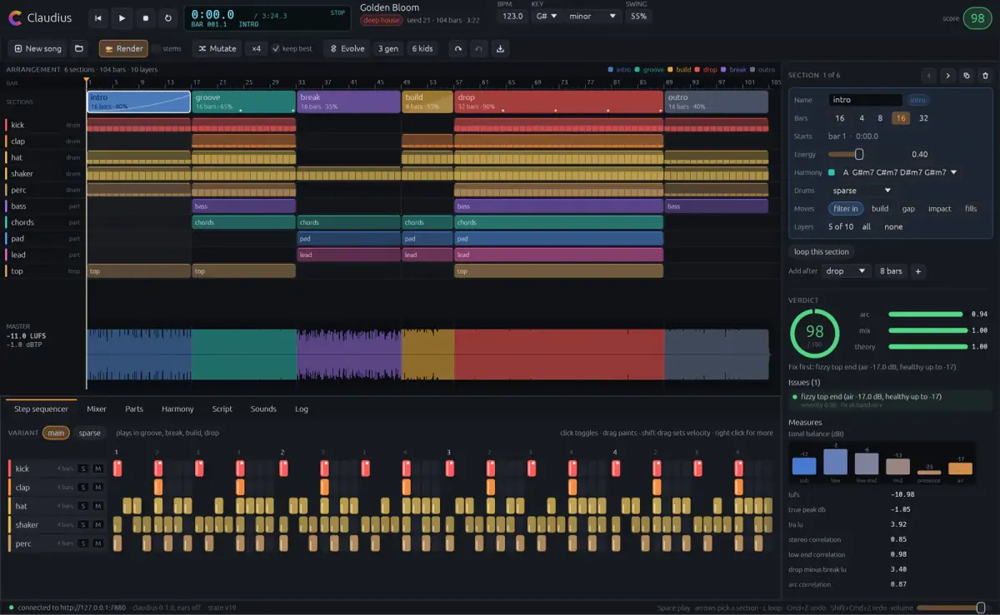

# claudius

claudius makes music the way a producer does in a DAW. It picks sounds, writes drums, bass, chords and melodies
with music theory, arranges them into a song with builds and drops, mixes and masters it, listens to the result,
and changes what it does not like.

Every sound is real audio: synthesized in code, or recorded (a grand piano, a Rhodes, string sections, real TR-808
and TR-909 drum machines, Apple Loops, your own files). There is no neural audio generation and no General MIDI.
After every change, a critic judges the song (loudness, tonal balance, the energy of the arrangement, music theory,
and what an audio model hears) and says what to fix.

You can work with it in a studio app, in a small script language, through an assistant such as Claude or ChatGPT,
or from the command line.



**[Documentation](docs/src/SUMMARY.md)** · **[Releases](https://github.com/devlato/claudius/releases)**

## Install

Download Claudius from the [website](https://claudius.devlato.com/#install) or the
[releases page](https://github.com/devlato/claudius/releases/latest):

- **Mac**: the disk image for Apple silicon or Intel. Open it and drag Claudius into Applications
  ([the first time you open it](docs/src/getting-started/install.md#the-mac-app)).
- **Windows**: the `.msi`, which puts Claudius in the Start menu.
- **Linux**: the `.deb`, the `.rpm` or the AppImage.

The studio downloads its listening models by itself the first time it opens, and offers the sample packs. From a
terminal instead:

```sh
curl -fsSL https://github.com/devlato/claudius/releases/latest/download/install.sh | sh    # macOS (the app too), Linux
irm https://github.com/devlato/claudius/releases/latest/download/install.ps1 | iex          # Windows (PowerShell)
claudius setup    # sample packs and listening models, about 3 GB to download
```

You can also build it from source; see [install](docs/src/getting-started/install.md).

## A first look

```sh
claudius make --genre lofi          # a finished song in ./out/lofi-<title>-<seed>/song.wav
claudius studio                     # the studio, with the engine inside
claudius connect claude-desktop     # MCP and skills; then ask Claude for a song while you listen
```

Your assistant's own command works too: `claude mcp add --scope user claudius -- claudius mcp`, `codex mcp add
claudius -- claudius mcp`, or Cursor's install link ([the assistant's own command](docs/src/getting-started/assistants.md#with-the-assistants-own-command)).

A song in the script language:

```js packs
blank("lofi"); tempo(84); key("D minor"); swing(0.58);
prog("A", "Dm9 Gm9 Bbmaj7 A7");
track("drums", s("bd ~ ~ bd, ~ sd, hh*8?0.15").bank("tr808"));
track("keys",  chord("prog").voicing(50, 72).s("rhodes").room(0.3));
track("bass",  chord("prog").root().struct("x ~ ~ x ~ x ~ ~").s("upright_bass"));
form([sec("intro", 4, "keys"), sec("groove", 16, "*"), sec("break", 8, "keys"), sec("groove", 16, "*")]);
```

`claudius script song.rhai` renders it and prints the verdict. Any song claudius makes prints back as a script like
this, so a script is also the way to read a song.

## Documentation

- [Your first song](docs/src/getting-started/first-song.md), then
  [learn to make music](docs/src/learn/basics/how-a-track-is-built.md) if you have never made any.
- [claudius for DAW users](docs/src/learn/producers/daw-users.md) and the
  [language reference](docs/src/language/overview.md) if you have.
- [Working with an assistant](docs/src/getting-started/assistants.md) (MCP and [skills](skills/README.md): Claude,
  ChatGPT, Cursor, Codex).
- [Architecture](docs/src/engineering/architecture.md), [design decisions](docs/src/design/README.md) and
  [a tour of the repository](docs/src/contributing/onboarding.md) for working on claudius.

The book's pages are in [`docs/src`](docs/src/SUMMARY.md); `cargo xtask site` builds them into a website with
[mdBook](https://rust-lang.github.io/mdBook/).

## Privacy

claudius sends nothing about you or your music anywhere. Anonymous usage statistics (the command, the version, the
system, where a setup or a crash failed) stay off unless you say yes when the studio asks, or run
`claudius telemetry on`; [privacy](docs/src/guide/privacy.md) lists every field.

## Contributing

See [CONTRIBUTING.md](CONTRIBUTING.md). Security reports go through GitHub's private reporting, described in
[SECURITY.md](SECURITY.md).

## Licence

claudius is MIT-licensed ([LICENSE](LICENSE)). The sample packs and listening models it downloads have their own
licences, all of which allow making and publishing music; [NOTICE](NOTICE) lists them.
